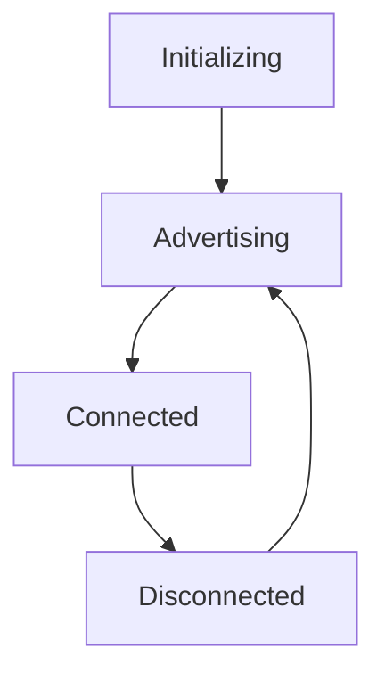

# ESP32 BLE Keyboard

## Description

ESP32 implementation of BLE HID protocol.

### Hardware Required
- ESP32S3 (reads inputs, sends HID reports over BLE)
- button1 (media Pause key)
- button2 (media Play key)
- rotary encoder (media Volume Up/Down keys)
- LED (On when BLE is connected, Off when BLE is disconnected)

### GPIO map
| Compponent pin | ESP32 Pin |
|----------------|-----------|
| LED            | GPIO4     |
| Button1 Out    | GPIO5     |
| Button2 Out    | GPIO6     |
| Encoder S1     | GPIO7     |
| Encoder S2     | GPIO8     |

### BLE State Machine


## Menuconfig Options for Power Optimization

Some configurations can reduce system power consumption at the cost of minor RAM overhead and limited auxiliary functions.

### Placing Core Functions in IRAM

Moving frequently executed core code from flash to IRAM improves running efficiency and reduces system power consumption with the trade-off of higher static RAM occupation.

#### Sleep Related Functions in IRAM

- `CONFIG_PM_SLP_IRAM_OPT`
- `CONFIG_PM_RTOS_IDLE_OPT`

#### FreeRTOS Kernel Functions in IRAM

- `CONFIG_FREERTOS_IN_IRAM`

## How to use example

### Configure the project

```
idf.py menuconfig
```

1. Configure RTC clock source:
   - `Component config > Hardware Settings > RTC Clock Config > RTC clock source`
2. Enable power management:
   - `Component config > Power Management > [*] Support for power management`
3. Configure FreeRTOS:
   - `Component config > FreeRTOS > Kernel`
     -  `(1000) configTICK_RATE_HZ`
     -  `[*] configUSE_TICKLESS_IDLE`
     -  `(3)     configEXPECTED_IDLE_TIME_BEFORE_SLEEP`

#### For Chip ESP32/ESP32-C3/ESP32-S3

4. Enable power down MAC and baseband:
   - `Component config > PHY > [*] Power down MAC and baseband of Wi-Fi and Bluetooth when PHY is disabled`
5. Enable bluetooth modem sleep:
   - `Component config > Bluetooth > Controller Options > MODEM SLEEP Options`
     - `[*] Bluetooth modem sleep`
     - `[*]     Bluetooth Modem sleep Mode 1`
6. Configure bluetooth low power clock:
   - `Component config > Bluetooth > Controller Options > MODEM SLEEP Options > Bluetooth modem sleep > Bluetooth Modem sleep Mode 1 > Bluetooth low power clock`
7. Enable power up main XTAL during light sleep:
   - `Component config > Bluetooth > Controller Options > MODEM SLEEP Options > [*] power up main XTAL during light sleep`

### Build and Flash

```
idf.py set-target ESP32S3 build
```

To flash the project and see the output, run:

```
idf.py -p PORT flash monitor
```

(Replace PORT with the name of the serial port to use.)

(To exit the serial monitor, type ``Ctrl-]``.)

See the Getting Started Guide for full steps to configure and use ESP-IDF to build projects.

## Current draw
Prior to adding Modem and automtic Light sleep current draw was ~65-70 mA. After enabling sleep modes current draw is ~37-40 mA.

## What to improve
- Watch points are hardcoded in encoder.c. Make it configurable
- Refactor BLE related code. Part of it just copied from Espressif examples.
- There is also Sleep state in BLE FSM. Test if it's handled correctly in callback.